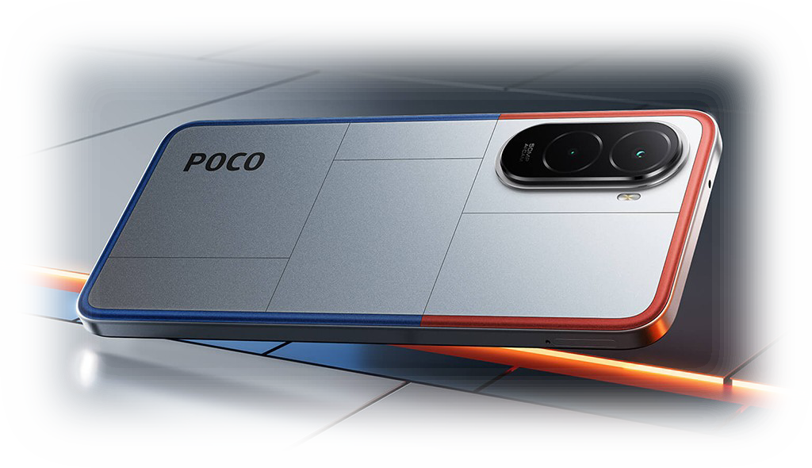

<div align="center">

## Welcome to the active source code hub for **Xiaomi POCO M7 4G / Redmi 15 4G (`creek`)**.


Note: This is an actively maintained Xiaomi Creek organization for POCO M7 4G / Redmi 15 4G custom ROM bringup, device tree.

<p align="center">
  <a href="https://t.me/LineageOS_creek"></a>
  <a href="https://t.me/los_creek"></a>
  <a href="https://github.com/XiaomiCreek/android_device_xiaomi_creek/commits/lineage-23.2"></a>
  
</p>



[](https://git.io/typing-svg)

</div>

---

## 📱 Supported Custom Roms

<div align="center">
  <table>
    <thead>
      <tr>
        <th align="center" width="160">ROM Name</th>
        <th align="center" width="100">Android Version</th>
        <th align="center" width="140">Maintainer</th>
        <th align="center" width="160">Download</th>
      </tr>
    </thead>
    <tbody>
      <tr>
        <td align="center"><b>LineageOS</b></td>
        <td align="center"><code>17</code></td>
        <td align="center">
          
        </td>
        <td align="center">
          <a href="https://sourceforge.net/projects/xiaomicreek/files/17/LineageOS/">
            
          </a>
        </td>
      </tr>
      <tr>
        <td align="center"><b>EvolutionX</b></td>
        <td align="center"><code>11.10</code></td>
        <td align="center">
          
        </td>
        <td align="center">
          <a href="https://sourceforge.net/projects/xiaomicreek/files/EvolutionX/16/">
            
          </a>
        </td>
      </tr>
      <tr>
        <td align="center"><b>PixelOS</b></td>
        <td align="center"><code>16</code></td>
        <td align="center">
          
        </td>
        <td align="center">
          <a href="https://sourceforge.net/projects/xiaomicreek/files/PixelOS/16/">
            
          </a>
        </td>
      </tr>
    </tbody>
  </table>
</div>

---

## 📦 Core Repositories
* **Device Tree:** [`android_device_xiaomi_creek`](https://github.com/XiaomiCreek/android_device_xiaomi_creek)
* **Vendor Tree:** [`android_vendor_xiaomi_creek`](https://github.com/XiaomiCreek/android_vendor_xiaomi_creek)
* **Kernel Tree:** [`android_kernel_xiaomi_creek`](https://github.com/XiaomiCreek/android_kernel_xiaomi_creek)

---

## ✨ What Makes this device Special!?

<table align="center">
  <tr>
    <td width="240px"><b>SoC</b></td>
    <td width="650px">Qualcomm SM6225 Snapdragon 685 (6 nm)</td>
  </tr>
  <tr>
    <td><b>CPU</b></td>
    <td>4x2.8 GHz Cortex-A73 & 4x1.9 GHz Cortex-A53</td>
  </tr>
  <tr>
    <td><b>GPU</b></td>
    <td>Adreno 610</td>
  </tr>
  <tr>
    <td><b>Memory</b></td>
    <td>6GB/8GB RAM (LPDDR4X)</td>
  </tr>
  <tr>
    <td><b>Storage</b></td>
    <td>128GB/256GB UFS 2.2 (Expandable up to 2TB via SD)</td>
  </tr>
  <tr>
    <td><b>Shipped Android version</b></td>
    <td>15.0 with HyperOS 2</td>
  </tr>
  <tr>
    <td><b>Battery</b></td>
    <td>Non-removable Silicon-Carbon 7000 mAh</td>
  </tr>
  <tr>
    <td><b>Dimensions</b></td>
    <td>169.48 x 80.45 x 8.4 mm</td>
  </tr>
  <tr>
    <td><b>Display</b></td>
    <td>1080 x 2340 pixels, 19.5:9 ratio 6.9" inch</td>
  </tr>
  <tr>
    <td><b>Type</b></td>
    <td>IPS LCD, 144Hz, 850 nits (HBM)</td>
  </tr>
  <tr>
    <td><b>NFC</b></td>
    <td>Yes (Region dependent)</td>
  </tr>
  <tr>
    <td><b>Main Camera</b></td>
    <td>50 MP f/1.8 (Wide) + Auxiliary Lens</td>
  </tr>
  <tr>
    <td><b>Front camera</b></td>
    <td>8 MP, f/2.0 (wide)</td>
  </tr>
  <tr>
    <td><b>Protection</b></td>
    <td>IP64 + Wet Touch 2.0</td>
  </tr>
  <tr>
    <td><b>Weight</b></td>
    <td>214g</td>
  </tr>
  <tr>
    <td><b>Max Wired Input</b></td>
    <td>33W (Turbo Charging)</td>
  </tr>
  <tr>
    <td><b>Reverse Charging</b></td>
    <td>18W Wired (Power bank mode)</td>
  </tr>
  <tr>
    <td><b>0-100% Time</b></td>
    <td>~96 Minutes</td>
  </tr>
  <tr>
    <td><b>Battery Protection</b></td>
    <td>Battery Health 4.0 / Smart Charging Engine 2.0</td>
  </tr>
</table>

---

## 🚀 Building from Source

- Initialize local repository
```
repo init -u https://github.com/LineageOS/android.git -b lineage-23.2 --git-lfs
```

- Clone your local manifest for Device
```
git clone https://github.com/XiaomiCreek/android.git -b 16 .repo/local_manifests
```

- Sync up
```
repo sync -c -j$(nproc --all) --force-sync --no-clone-bundle --no-tags
```

- Set up the build environment
```
. build/envsetup.sh
```

- Breakfast the target
```
Breakfast creek userdebug
```

- start compiling
```
m bacon
```
---

## 🔐 Security & Transparency

Creek device tree is **fully open source**. Every line of code is publicly available for review — from system components to build scripts. We believe users have the right to inspect what's running on their devices.

When choosing a custom ROM, we recommend:

- ✅ Verifying that source code is publicly available
- ✅ Reviewing recent commit history and development activity
- ✅ Checking maintainer reputation and community trust

---

<div align="center">
  
### ⭐ Thanks for checking out Project XiaomiCreek!

**Now focused on Android 16 — let's keep *creek* alive together 🚀**

</div>
